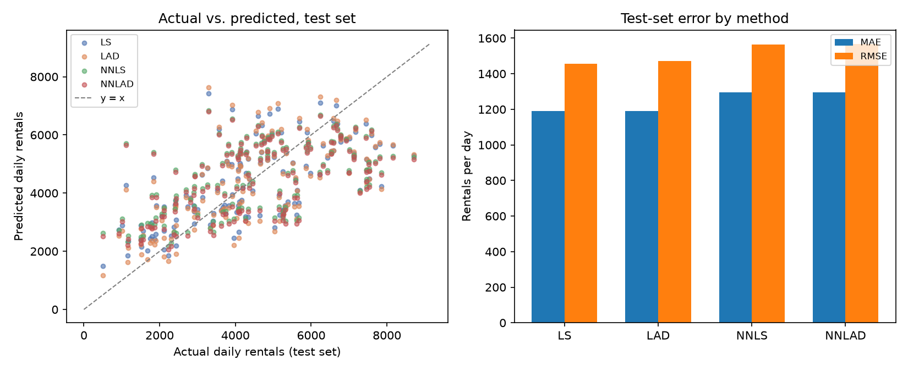

# Regression Methods Report

This file is the report template for the activity. Complete it using results from your own analysis; do not include unsupported claims or results copied from another group.

## Deliverables

Submit:

1. This completed `REPORT.md` file.
2. The completed `output/submission.csv` coefficient file.
3. Any figure files referenced by the report, stored in a `figures/` folder.

Keep the report concise: approximately 800 words or fewer, excluding tables and figure captions. Use one coefficient table, one performance table, and at least one meaningful figure.

## 1. Question and experimental design

The question is how well daily bike-rental demand (`cnt`) can be predicted from three weather measurements — normalized temperature (`temp`), humidity (`hum`), and wind speed (`windspeed`) — using a single linear equation:

```text
predicted cnt = b_0 + b_1(temp) + b_2(hum) + b_3(windspeed)
```

The 731 daily observations in `resources/day.csv` were shuffled (fixed seed) and split roughly 60/20/20 into `data/training.csv` (439 rows), `data/validation.csv` (146), and `data/testing.csv` (146). All four coefficient sets were fit using only the training rows; testing was touched exactly once, after fitting, for Section 4. Validation was inspected only afterward (Section 7). Because the split randomly interleaves days from two years rather than holding out a later period, this is a methods-comparison exercise, not a genuine demand forecast.

## 2. Methods

| Method | What it minimizes | Coefficient constraints | When it may be appropriate |
|---|---|---|---|
| LS | Sum of squared residuals | None | Default choice when residuals are roughly symmetric and large errors should be penalized heavily; sensitive to outliers because errors are squared. |
| LAD | Sum of absolute residuals | None | Preferred when the data contain outliers or heavy-tailed noise (e.g., weather extremes, holiday spikes) that would otherwise dominate a squared-error fit. |
| NNLS | Sum of squared residuals | `b_1, b_2, b_3 ≥ 0` | Appropriate when domain knowledge says every predictor can only help the outcome (e.g., a production function), so a negative weight would be physically nonsensical even if the data suggest one. |
| NNLAD | Sum of absolute residuals | `b_1, b_2, b_3 ≥ 0` | Combines the outlier-robustness of LAD with a nonnegativity requirement; useful when both conditions above apply. |

The loss function determines how a residual's size is penalized (quadratic vs. linear), changing which observations the fit is most sensitive to. The nonnegativity constraint instead restricts which solutions are *allowed*, independent of the loss — either loss can be paired with either constraint set, as the four rows show. A constraint can therefore drag a model off its unconstrained optimum even though it says nothing about how errors are weighted.

## 3. Estimated coefficients

Coefficients estimated from `data/training.csv`:

| Method | `b_0` | `b_1_temp` | `b_2_hum` | `b_3_windspeed` |
|---|---:|---:|---:|---:|
| LS | 3659.29 | 6694.72 | -2672.61 | -4462.74 |
| LAD | 3762.36 | 7178.51 | -3170.80 | -4853.73 |
| NNLS | 1176.47 | 6659.69 | 0.00 | 0.00 |
| NNLAD | 1041.18 | 6779.13 | 0.00 | 0.00 |

LS and LAD agree that higher humidity and wind speed are both associated with *fewer* rentals — both slopes are clearly negative under both loss functions. NNLS and NNLAD can't represent that: `hum` and `windspeed` are pushed to exactly 0, the boundary of the allowed region, since the unconstrained data want a negative slope, not a small positive one. This differs from shrinkage methods (e.g., ridge), which pull a coefficient toward zero without necessarily forcing it there. With two predictors zeroed out, the nonnegative models compensate with a smaller intercept and a larger `temp` coefficient, the only predictor still free to carry the weather signal.

## 4. Test-set performance

Predictions use `data/testing.csv` with each method's training-derived coefficients.

| Method | Test MAE | Test RMSE |
|---|---:|---:|
| LS | 1190.77 | 1457.36 |
| LAD | 1189.84 | 1470.53 |
| NNLS | 1296.72 | 1563.55 |
| NNLAD | 1295.98 | 1567.84 |

LS and LAD are close to each other and both clearly outperform NNLS and NNLAD on both metrics (roughly 100 fewer rentals/day of error). This follows directly from Section 3: forcing `hum` and `windspeed` to zero throws away real predictive signal, and that constraint matters far more here than the choice of loss function.

## 5. Graphical evidence



The left panel plots predicted vs. actual test-set rentals against the y = x line; LS and LAD (blue/orange) track the diagonal noticeably better than NNLS and NNLAD (green/red), whose points sit visibly high in the low-rental range — consistent with over-predicting calm, humid, low-demand days once that signal is zeroed out. The right panel shows the same gap as MAE/RMSE, matching Section 4.

## 6. Recommended method

LS and LAD are close enough (0.9 rentals/day apart on MAE, 13 on RMSE) that neither dominates — each does marginally better on the metric it was built to minimize, as expected. I'd lean toward **LAD**: daily counts include weather/event extremes that can produce large residuals, and LAD's linear penalty limits how much a handful of such days can pull the fit, at essentially no cost here. That preference is a judgment call about robustness, not something the numbers alone force. The nonnegative variants are not recommended: the constraint isn't supported by the data and costs real accuracy.

## 7. Was validation needed?

Not for this exercise as run: all four methods were specified in advance and fit once each, with no model-selection step for a validation set to inform. Checking it after the fact (MAE: LS 1261.20, LAD 1249.75, NNLS 1351.22, NNLAD 1351.97) reproduces the test-set ranking, which is reassuring but not information this analysis needed. Validation would become necessary the moment the workflow included a choice based on held-out performance — picking between LS and LAD, selecting predictors, or tuning a regularization strength — since the training set always favors whatever is most flexible, and the test set must stay unseen until one final evaluation. Using the test set to make such a choice would silently turn it into a second validation set and invalidate the numbers in Section 4.

## 8. Something interesting

The clearest finding isn't which loss function wins — it's that the nonnegativity constraint is all-or-nothing here, not graceful. Because `hum` and `windspeed` are genuinely negatively associated with `cnt`, NNLS and NNLAD snap both to exactly 0.00 rather than some small positive compromise, discarding two of three predictors; the constrained/unconstrained split changes the model qualitatively, while squared vs. absolute loss barely matters. More generally, test RMSE around 1450-1570 against a `cnt` range of roughly 22-8714 shows plenty of variance is still unexplained by weather alone — season, weekday, and holiday status (in `resources/day.csv`, excluded here by design) would likely matter more than the choice among these four methods.

## Reproducibility note

Python 3.12 via `uv` (`numpy` 2.5, `scipy` 1.18, `pandas` 3.1, `matplotlib` 3.11; see `uv.lock`). LS: `numpy.linalg.lstsq`. NNLS: `scipy.optimize.lsq_linear`, intercept bound `(-inf, inf)`, slopes bound `[0, inf)` (trust-region reflective, not post-hoc clipping). LAD/NNLAD: linear programs via `scipy.optimize.linprog` (HiGHS) — one auxiliary variable `u_i ≥ |residual_i|` per observation, minimizing `sum(u_i)`, slopes additionally bounded `[0, inf)` for NNLAD. Nonnegativity was checked against a `1e-8` tolerance. Code: `src/fit.py`, run via `uv run python src/fit.py`.
